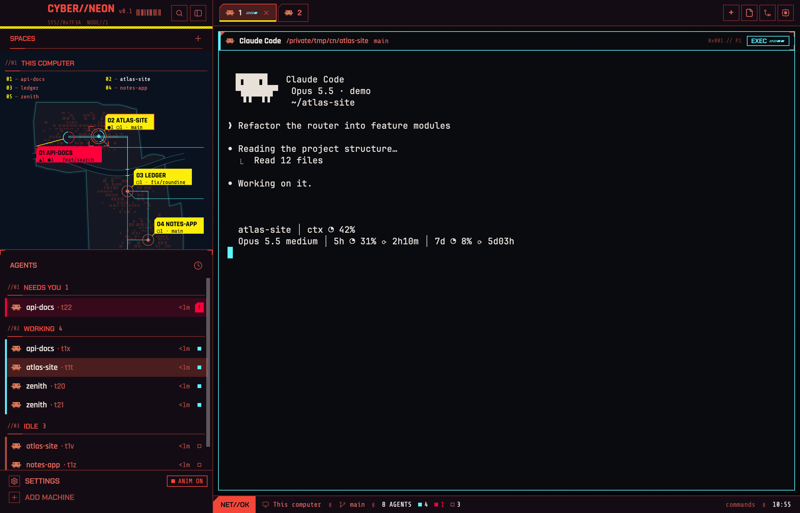

# Cyberpunk-Neon

A Herdr Desktop layout inspired by the user interface of Cyberpunk 2077: red-on-black panels, cut corners, a city map of your spaces, and a GitHub job journal.



Version 0.1.0 · Apache-2.0 · for Herdr App 0.1.15 or later · fan-made, not affiliated with CD PROJEKT RED

## What you get

- **Space map**: your spaces as points on a generated city map with coast, river and roads. They're placed A to Z by name, with yellow labels (agents, branch, open milestones and issues) and a numbered legend. Hover a point to see every agent in that space.
- **Agents list with a scanner**: hover an agent for a scan card with its class, state, uptime, path and branch, live context and 5h/7d usage (Claude Code and Codex), and a THREAT meter.
- **JOBS journal**: for a GitHub repo, the current branch's PR is the main job, with CI checks, review and task boxes as objectives. Your assigned issues are side jobs, and milestone issues are gigs. There's a RISK level per job, a tracked job, and a floating job HUD you can minimize or close.
- **Everything restyled**: tabs, pane headers, menus, a hacking-style `cmd-p` picker, in-game style notifications and a status readout. Blocked agents are impossible to miss.
- **`ANIM ON/OFF`** in the sidebar footer turns every animation off.

## Install

```sh
git clone https://github.com/p988744/cyberpunk-neon && cd cyberpunk-neon
H=~/.config/herdr-app
cp layouts/Cyberpunk-Neon.json $H/layouts/ && cp themes/Cyberpunk-Neon.json $H/themes/ && cp -R mods/cyberneon-* $H/mods/
herdr-app do layout.switch '{"name":"Cyberpunk-Neon"}'
```

- Merge `keys.json` into `~/.config/herdr-app/keys.json`. Its `layout:Cyberpunk-Neon` section makes `cmd-p` open the hacking-style picker in this layout only.
- On a first install, switch to another layout and back once: Herdr loads the layout's fonts on the next look change.
- To go back to your own layout, press `ctrl-shift-l`. Deleting the copied files removes it.

## What it runs and reaches

- `git` (read-only) in your spaces' folders, to find branches and GitHub remotes.
- `gh` with your own login, **read-only**, only for folders whose remote is on github.com. It calls `pr view`, `issue list`, `issue view` and `api …/milestones`, plus one GraphQL count of open issues and milestones per repo, at most every 2 to 10 minutes. It never writes to GitHub.
- `hc read <terminal>` once when you open an agent's scan card, to read its status line (context and usage).

Nothing else leaves your machine.

## Docs

- `RECIPE.md`: the full brief (what you see, how it behaves, how it's built, gotchas). It's also how to rebuild it from scratch.
- `docs/DESIGN.md`: the early design notes (in Traditional Chinese).
- Each `mods/cyberneon-*/NOTES.md`: per-mod details and pitfalls.

## License

Apache-2.0, see `LICENSE`. Parts are adapted from Herdr's shipped mods (Apache-2.0), and the fonts are SIL OFL 1.1. See `THIRD_PARTY_NOTICES.md`.
Cyberpunk 2077 is a trademark of CD PROJEKT S.A. This project uses no game assets and isn't endorsed by CD PROJEKT RED.
