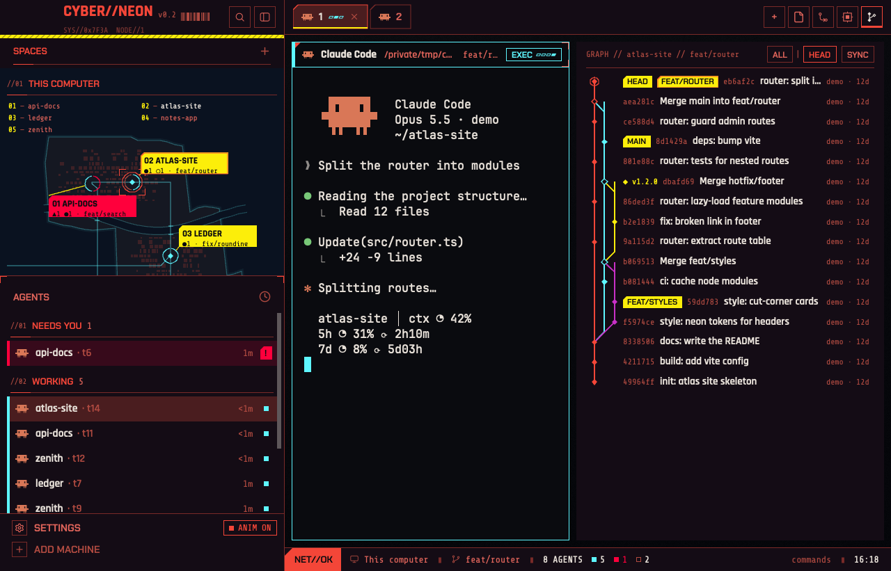

# Cyber-Neon

A black-and-red Herdr window in the style of a near-future game HUD. A 340px sidebar holds a glitching `CYBER//NEON` wordmark, a procedural city map where every space is a diamond on an island with a yellow tag, and an agents list with chips like `EXEC`, `INPUT REQ` and `COMPLETE`. Tabs and pane headers have 45° cut corners, thin red rules and cyan data bars. A JOBS journal on the right and a floating JOB card at the top right of the terminals track the current branch's pull request, milestone and assigned issues from GitHub. The status bar reads `NET//OK ▮ machine ▮ branch ▮ N AGENTS`. Cyan means active, yellow means look at this, and bright red is kept for an agent that needs you. All motion stops with one `ANIM OFF` switch.



**This is an unofficial fan work and is not approved/endorsed by CD PROJEKT RED.** Inspired by Cyberpunk 2077's interface. It uses no game assets, logos or fonts, and it isn't affiliated with CD PROJEKT RED. Every shape, icon and map is drawn from code or by hand. The fonts are open (OFL).

---

## What you see

### Palette (`themes/Cyber-Neon.json`)

The theme file only takes `#rrggbb`, so every semi-transparent color is either mixed into a solid hex or written as a `#rrggbbaa` string in code.

| Herdr color | Hex | Used for |
|---|---|---|
| `canvas`, `background` | `#0A0B0F` | window floor, terminals, pane headers |
| `chrome`, `surface` | `#140C15` | sidebar, tab bar, status bar, right panel (purple-black) |
| `raised`, `popover` | `#1C1220` | menus, cards, toast |
| `hover` | `#2A1418` | hover fill |
| `selected` | `#4A1D1F` | selected rows, active tab (dark red) |
| `border` | `#7A2A28` | every 1px line |
| `input` | `#5EF6FF` | input focus |
| `foreground` | `#E8E1D9` | body text (never red: long red text tires the eye) |
| `muted` | `#E0645A` | labels, secondary text |
| `dim` | `#B04A40` | timestamps, data lines, decoration |
| `accent` | `#F44638` | headings, rules, brand, active edges |
| `accent_foreground` | `#0A0B0F` | text on accent |
| `solid` / `solid_foreground` | `#FCEE0A` / `#0A0B0F` | yellow tags with black text |
| `working` | `#5EF6FF` | cyan |
| `blocked` | `#FF003C` | bright red, only for this |
| `done` | `#FCEE0A` | yellow |
| `idle` | `#B04A40` | |
| `unknown` | `#3A2A2E` | |

Terminal: background `#0A0B0F`, foreground `#E8E1D9`, cursor `#5EF6FF`, selection `#4A1D1F`. ANSI 0-15 (Scarlet Protocol, MIT): `#101116 #ff0051 #01dc84 #faf945 #0271b6 #c930c7 #00c5c7 #c7c7c7 #686868 #ff6e67 #60fa68 #fffc67 #6871ff #bd35ec #60fdff #ffffff`.

The map adds two hard-coded colors: sea `#0A1220` and land `#151822`.

Measured contrast on the dark ground: `foreground` 14.8:1, `muted` 5.6:1, `dim` 3.6:1 (so `dim` is only for secondary data).

### Type

| Role | Font | Where |
|---|---|---|
| UI (`ui_font`), titles | Rajdhani SemiBold 600 / Bold 700 | wordmark 19px, pane names 13px, PR title 14px, tags 11px |
| Labels, chips, tabs | Chakra Petch Regular / SemiBold 600 | tabs 12px, chips 10-10.5px, section labels 11px |
| Numbers, IDs, data lines | Share Tech Mono | status bar 11px, data lines 9px, times 11px |
| Terminal (`font`) | JetBrains Mono 14px | Herdr's own font |

Only Rajdhani SemiBold and Bold ship (no Regular, no Medium), so plain text falls to SemiBold and reads a bit heavier on the dark ground, which is the intent. Labels are caps. Herdr has no letter-spacing.

### Window

Root is a row with no titlebar (`titlebar: "none"`, macOS traffic lights at `[12, 16]`), a 170° gradient `#0A0B0F → #05060A`, 1px `border` dividers and terminal padding `[14, 12]`. Left: the sidebar (340px). Right: the work column.

### Sidebar (340px, `chrome`, not resizable)

Top to bottom: brand (46px), the space map and the agents list (equal weight, each at least 90px), footer (69px). Under 160px wide it turns into a rail (see How it behaves).

**Brand (46px, window drag).** Left padding 14px (76px on macOS when not fullscreen, to clear the traffic lights).
- Wordmark `CYBER//NEON` in Rajdhani Bold 19px `accent`. Behind it sit a cyan (`working`) copy at left −2px and a red (`blocked`) copy at left +2px. Both flick in for about 100ms once every 3s: an RGB-split glitch, the window's only always-on motion.
- Then `v0.1` in Share Tech Mono 10px `dim`, then a 40px fake barcode: 14 bars of 1-3px with 0-2px gaps, 10px tall, `dim`.
- Under it, a data line `SYS//0x7F3A  NODE//<number of machines>` in Share Tech Mono 9px `dim` at 70% opacity, truncating.
- Right: two 26px square icon buttons with a 1px `border` (search, sidebar fold). On hover they get a `hover` fill and an `accent` border.
- Along the bottom edge runs a 4px hazard band, `solid` yellow with dark diagonal stripes (`#0a0b0f59`, width 2, every 6px), full width, also on the rail.
- When the app starts, the wordmark types itself once: a `chrome` cover with an `accent` `▌` cursor slides right off the word in 480ms. Then the glitch copies appear.

**Space map (`cyberneon-spaces`).** Background is the sea `#0A1220`. Header row 31px: `SPACES` in Chakra Petch SemiBold 11px `accent` caps, a `+` button (new space) at the right, then the section rule. Every section rule in this layout is the same: 1px `border` with a 24px `accent` segment at its left end.

Then one region per machine, "This computer" first, then remote machines in name order. Regions after the first are split by a dashed 1px `dim` line (4px on, 3px off). A region on a machine that isn't ready is drawn at 40% opacity. Each region has:
1. **Header:** `//01` (Share Tech Mono 9px `dim`) and the machine name (Chakra Petch SemiBold 11px `accent` caps), then the rule.
2. **Legend:** two columns, 14px rows, Share Tech Mono 9px: `01 — atlas-site`, with the number in `solid` yellow, the name in `muted` (`foreground` for the active space). Numbers run A-Z by name in each region and keep counting across machines.
3. **Map**, all procedural and seeded by the machine name, so the same spaces always give the same island:
   - Land `#151822`, an island with a wobbly coast (about 76 vertices; inlets at most 9px deep), outlined with 1px `working` at 30% plus a 5px coastal glow at 6%. 1-3 small islets below it.
   - A river (the widest band no space touches; horizontal if possible, else vertical): a 4-8px sine-curved strip of sea with faint cyan banks (25%). Roads that cross it get two 6px bridge rails (`working` 80%).
   - Roads in `working` at 60%: each space joined to its 1-2 nearest neighbours by two-segment elbows, plus 2-3 highways to the island's edge.
   - Suburbs: 2-5px city blocks in `accent` at 18%, clustered within 50px of each point (dense up to 20px, fading out by 50px), none inside 14px of a point, none on the river.
   - **Points.** Each space sits in a 44px cell, with neighbours at least 48px apart. A space's place comes from its name: the first letter picks one of 26 sectors A-Z, the second letter the spot inside it, so `api-docs` lands top left and `ledger` lands further on. In the middle is a 7px diamond in the space's most urgent agent state (`muted` when idle or empty). Around it is a ring of radius 9px, split into one arc per agent (up to 12, about 2px gaps), each arc in that agent's state color. A space with no agents gets a full `muted` ring. The active space gets an `accent` ring of radius 12 plus 8px `accent` corner brackets at ±16px.
   - **Worktree spaces orbit their repo.** A space whose folder (its first pane's, else the space's) is under Herdr's `~/.herdr/worktrees/<repo>/<branch>` gets no district of its own. It shares its repo's point: its agents join that point's ring and hover card, the point is active when it is, and the repo's tag gets one more 10px line, `↳ M1 ●1 · #4 ○1` (named by its worktree folder, else its branch, `milestone-<n>…`/`issue-<n>…` shortened to `M<n>`/`#<n>`, so a lead that switched branches still reads `M<n>`, others cut to 10 characters; at most 3, then `+n`; clicking it selects the worktree space when there's just one). The legend still lists it as `06a`, `06b` after its repo. The repo's space is another space on the same machine with a `<repo>` folder segment, the one closest to the repo root (`worktreeParents()`); none found → its own district as before.
   - **Tags.** Each point has a yellow tag on a leader line. Line 1: `01 ATLAS-SITE` in Rajdhani Bold 11px. Line 2: Share Tech Mono 8.5px, `▲1 ●2 ○1 · feature/login · ◆2◇14` (blocked, working, idle counts, the branch cut to 12 characters, then open milestones and issues on GitHub; zero parts are left out). The tag is `solid` yellow (`blocked` red if any agent there is blocked), with `solid_foreground` text and a 4px top-left cut. The active space's tag has a 1px `accent` edge. Leaders are 1px `solid` lines from the tag's nearest corner to the ring. Tags never overlap each other or a point, and no leader crosses a tag.

**Agents list (`cyberneon-agents`).** Title row: `AGENTS` in Chakra Petch SemiBold 11.5px `muted`, 8px `accent` corner brackets at its top-left and top-right, and a square sort button (clock icon) on the right.

Groups, each with a header: `//01` (Share Tech Mono 9px `dim`), the label (Chakra Petch SemiBold 11px `accent`), the count (Share Tech Mono 11px `muted`), then the section rule. In the default Priority view the groups are `PINNED` (if any), then `NEEDS YOU`, `DONE`, `WORKING`, `IDLE`. In the Grouped view they are space names, kept in their own case.

Rows are 30px, square, with a 3px left bar in the row's own state color and 7px left padding. A focused row gets the `selected` fill, and its text is always `foreground`. A blocked row that isn't focused is tinted `#FF003C26`. Each row shows the program icon, the name (12.5px), the machine name for remote agents (Share Tech Mono 10px `dim`), the time since the last state change (Share Tech Mono 11px `dim`: `<1m`, `12m`, `3h`, `2d`), and the state mark (see How it behaves). Sub-agents hang under their parent with square 1px `border` tree lines.

**Footer (69px, `chrome`, 1px `border` top).** Two 24px rows in Chakra Petch SemiBold 12px caps, each with an 18px square bordered icon box: `SETTINGS` (`muted`) and `ADD MACHINE` (`dim`). Hover gives a `hover` fill and `foreground` text. When an app update is ready, a 6×6 `accent` square sits on the Settings row. To the right of Settings is the animation switch: an 18px chip with a 1px border, Share Tech Mono 10.5px. On: a filled `accent` square and `ANIM ON` in `accent`. Off: a hollow `dim` square and `ANIM OFF` in `dim`.

### Tab bar (42px, `chrome`, 1px `border` bottom, window drag)

- Tabs are 28px chips, 10px side padding, Chakra Petch SemiBold 12px, with a 6px top-left 45° cut and a 1px outline that follows the cut.
  - Inactive: `chrome` fill, `muted` text, `border` outline. Hover: `hover` fill.
  - Active: `selected` fill, `foreground` text, `accent` outline, and a 2px `done` yellow line along the bottom. A close `×` (12px, `dim`) shows on the active tab only.
  - Content: program icon (14px), the title (max 170px, truncated; an unnamed tab shows its program's name, a zoomed one ends in ` Z`), then a status mark.
- On the right: `+` (new), then the panel toggles Files, Changes and Jobs, each a 26×26 square icon button with a 1px `border` outline and a tooltip in place of a label. A toggle that is on gets an `accent` outline and a 2px `accent` underline. On Windows, minimize / maximize / close buttons follow.
- On macOS, the bar leaves room for the traffic lights when the sidebar is narrow.

### Terminals (`main`)

`work-body` is a row with 8px padding and 8px gaps. Pane frames: square (radius 0), gap 8px, `background` fill, 1px `border`; the focused pane gets a 1px `working` cyan border. A lone pane is framed too.

**Pane header (30px, on top, always shown, `background` fill).**
- Left: a 3px strip in the pane's state color (`border` when no agent runs), and a 7px `accent` triangle notch at its top-left.
- Then the program icon (14px), the name (Rajdhani Bold 13px, max 260px, case kept), the folder in `muted` (home shown as `~`), and the branch in Share Tech Mono 11px `muted` when there is one. Unfocused panes show this group at 60% opacity.
- At 420px wide and up: a data label `0x01F // P2` (Share Tech Mono 9px `dim` at 70%). The hex is the terminal id (`t1f` → `0x01F`) and `P2` is the pane's place in its tab.
- Then the state chip (see How it behaves).
- On hover only: split right, split down, zoom/unzoom and close, each a 20×20 square button with a 1px `border` (hover: `hover` fill, `accent` border). The icons are hand-drawn 16px SVGs.
- The focused pane has a 1px `working` line under its header and 8px `accent` corner brackets at its right top and bottom. A blocked pane's header is tinted `#FF003C26` with a red line instead.

**Floating JOB HUD.** A floating block at the top edge of `main`, aligned to the end (top right, 12px in). Herdr draws its frame (theme background, border, rounded corners, shadow); people can drag it to another edge. Inside, 200-300px wide:
- Line 1: a yellow `JOB` tag (`SIDE JOB` for an issue, `MILESTONE` for a milestone; `solid` fill, Chakra Petch SemiBold 10.5px, 16px high), then `#142` (or `3/9` closed/total for a milestone) in Share Tech Mono 11px `muted`, then two 16px square buttons, `–` (minimize) and `×` (hide).
- Line 2: the title in Rajdhani Bold 14px, truncated.
- Up to 3 objectives not yet done, each an 8×8 square (hollow `muted` = open, `blocked` red = failing) and its text at 12px. Then `+N MORE` in Share Tech Mono 10px `dim`.
- With nothing to track, no GitHub repo, or a `gh` error, the HUD draws nothing and disappears.

### Right panel (368px, 280-900px, open on JOBS)

A stack, `panel-body`, with three pages switched by the tab bar's toggles: **Files** (Herdr's `files`), **Changes** (Herdr's `changes`), and **JOBS** (`cyberneon-jobs`, the default page, open from the first start).

- **Agents list: worktree spaces.** Wherever a row or group names its space (priority and pinned rows, space group headers, the scan card's DISTRICT), a worktree space reads `herdr-gallery ↳ M1`: its repo's space name, then the branch shortened as on the map. Same parent rule as the map, copied into the agents mod (`spaceNames()`), since mods can't import each other. Sorted by priority, a worktree space's agents (a milestone's lead and issue tabs) move as one: they take the most urgent member's rank, section and place, lead (`M<n>` tab) first, so an idle lead sits in WORKING right above its working issue tabs.

**JOBS journal (`chrome`, 12px side padding).**
- Header: `owner/repo // feature/login // 42S AGO` in Share Tech Mono 10px `dim` (`SYNCING` before the first fetch), then two square 20px buttons in Chakra Petch SemiBold 10px: `SYNC` (`SYNC…` while fetching) and `HUD` (lit `accent` while the HUD shows).
- Two sections, each opened by a red bar (an `accent` edge with a 12% `accent` fill, 6px top-left cut, the title in Chakra Petch SemiBold 11px `accent`, a two-digit count in Share Tech Mono 10px `muted`, and a `▽`/`▷` toggle):
  - `MAIN JOBS`: the branch's PR, the selected milestone, its inline milestone picker right under it (the milestone's title at 12px with `▾`; it opens a list in place), then every open issue in that milestone, whoever it's assigned to: the main quests. Empty: `NO PR // NO MILESTONE`.
  - `SIDE JOBS`: open issues with no milestone, anyone's (`gh issue list --search no:milestone`, at most 50). Issues in other milestones show when you pick that milestone.
- Cards are 46px with a 1px `border` (`accent` and `selected` fill when selected). A 30px emblem box (`raised`, 1px `muted`) holds `PR`, `IS` or `MS` in Share Tech Mono 11px, with a 5px corner mark (cyan open, yellow merged, hollow draft). The title is Rajdhani SemiBold 13px in `working` cyan. The second line is Share Tech Mono 9.5px: `#167 · RISK: HIGH · @login +1` (`M3` for a milestone), with the risk in `accent`, or `blocked` red for `VERY HIGH`. Issue cards end with the first assignee and `+n` for the rest in `foreground`, or `UNASSIGNED` in `dim` (`assignees` from `gh issue list`). Issue cards with labels grow a third row: up to 3 labels as a 6px square in the label's GitHub color plus its name in `muted` Share Tech Mono 9px, then `+n`. The tracked job has a 4px `solid` bar on its left and a small yellow target icon on its right. A section shows at most 30 cards, then `+n MORE`.
- Wide panel (560px and up): the list takes 42% of the width, then a 1px `accent` line, then the details. Narrow panel: the list alone; clicking a card shows the details with a `◂ BACK` button.
- Details: the title in Rajdhani Bold 18px (at most 54px tall), the objectives, the body rendered as markdown (`TextView.markdown`, selectable, links open in the browser; HTML comments from issue templates removed) inside a 12.5px `muted` div (`DECRYPTING…` while an issue body loads, `NO BRIEFING` when it is empty), and a `TRACK` / `UNTRACK` button.
- **Milestone → lead, issue → subagent.** Details of a milestone get `//03 LEAD`, of an issue `//03 AGENT`, pinned under the scroll area (1px `border` rule above it) and above TRACK / OPEN; the open dropdown grows it upward.
  - Running: `▶ EXEC  <space> / <tab>` in the state color and `JACK IN` (`space.select` + `pane.focus`, or `terminal.peek` for a background subagent). The card's second line ends with `· ▶ EXEC` too.
  - Not running: `NO LEAD // milestone-<n>-<slug>` or `NO AGENT // issue-<n>-<slug>`, then a 22px dropdown `AGENT // Claude Code ▾` (opens in place like the milestone picker; the agents from `knownAgents({on})` that are installed; picked key in `cyberneon.jobs.agent`) then a `YOLO` checkbox (10px box and Chakra Petch 10.5px label; ticked: `blocked` fill and text; dimmed and inert for an agent without a known flag; remembered in `cyberneon.jobs.yolo`), and the button. Ticked, LAUNCH and DISPATCH add the agent's own skip-permission flag (`yoloArgv()` in rules.js, keyed by `run[0]`: claude and agy `--dangerously-skip-permissions`, codex `--dangerously-bypass-approvals-and-sandbox`, opencode `--auto`, omp `--auto-approve`, grok `--always-approve`, hermes and gemini `--yolo`; pi has none). The lead hands the same command to its sub-agents.
  - `▶ LAUNCH` (milestone): `git worktree add -b milestone-<n>-<slug> ~/.herdr/worktrees/<repo>/<branch> HEAD`, then `space.new` there (a worktree space, so the map folds it into the repo's point) with tab `M<n>` running the picked agent (a space already open on that worktree is selected instead, so a second click doesn't start a second lead). The worktree is the lead's home, not an integration branch: one issue = one branch = one PR to the default branch. The lead coordinates and writes no code. Its task: read the milestone and its open issues, find the default branch, take over worktrees, agents and PRs left from earlier runs (`git worktree list`, `hc ls`, `gh pr list`), work out dependencies, start each issue whose dependencies are merged as its own sub-agent in a worktree off the freshly fetched default branch (exact `git fetch` / `git worktree add … origin/<default>` / `hc run --bg --name issue-<n> --cwd … -- <agent>` / `hc send` commands, the picked agent's command as is with no added flags), and follow them. Each sub-agent commits with `Closes #<n>`, pushes and opens its own PR. The lead never merges PRs, closes issues or closes the milestone: it tells the person which PR to merge to unblock what, and ends with the list of PRs to review in order and a reminder to close the milestone (GitHub never closes milestones). Its sub-agents show under it in the agents list, and it gets a note when one ends.
  - `▶ DISPATCH` (issue): one issue, one branch, one PR. A worktree on `issue-<n>-<slug>` off the main checkout's `HEAD` (the default branch), and the picked agent there with the issue as its task: commit with `Closes #<n>`, push, open a PR to the default branch, don't merge. With the milestone's lead running: `hc run --bg --json --parent <lead>` (a sub-agent of the lead, so Herdr keeps the link and the lead gets its notes), `terminal.keep` (a tab in the lead's space; it takes focus, which is what the click asked for), then `hc send --if idle` every 2s, up to 90s. Without a lead: a `#<n>` tab (`tab.new {space, folder, name, argv, task}`) in the project's space (whose folder or a pane is the main checkout); none open → `space.new` there.
  - A milestone with every issue closed but itself still open (GitHub never closes milestones) ends its card line with `ALL DONE → CLOSE M<n>` in `done`, and its `//03 LEAD` shows `ALL ISSUES CLOSED // close M<n> on GitHub (OPEN)` instead of LAUNCH. Closed milestones aren't fetched (`milestones?state=open`), so one disappears at the next refresh (2 min, or SYNC).
  - `PR #<n>` (in `done`; `PR #<n> DRAFT` in `muted`) ends an issue's card line when an open PR's head branch is `issue-<n>…` or `<n>-…`: one read-only `gh pr list --state open --json number,headRefName,isDraft` per fetch, mapped by `issuePRs()` (the lowest PR number wins). That's the issue waiting on your review.
  - Finding them: a lead is an agent pane on `milestone-<n>…` in the repo's main checkout or worktree root, or any agent pane in a `milestone-<n>-…` worktree folder whatever branch it's on (a lead may switch its checkout to an issue branch). An issue's agent is a pane on `issue-<n>…`/`<n>-…`, else a background terminal in an `issue-<n>…` worktree folder.
  - Slugs: the title's ASCII words, lowercase, dash-joined, at most 40 characters (`rules.js`). `DEPLOY_ARGV` (`["claude"]`) is the fallback when the agent list can't be read. These clicks are the mod's only writes: git worktrees and local terminals, never GitHub.
- No GitHub remote: `NO UPLINK // not a GitHub repo` in `blocked`. A `gh` failure: `NO UPLINK // gh not logged in` (or `rate limited`, or the first line of the error).

- **Files panel (`cyberneon-files`, a clone of Herdr's `files`, block id still `files`):** unchanged except for markdown (`.md`, `.markdown`, `.mdx`). Those open rendered with `TextView.markdown` in a scrollable 12px-padded area, selectable. The header gets an 18px chip, `SOURCE` (or `RENDER` when showing source), in Chakra Petch SemiBold 10.5px with a 1px `border` (`accent` on hover), which flips `cyberneon.files.render` (default rendered) for every markdown file. Source is the shipped read-only code view. Icons still load from `mods/files/`.

- **GRAPH page (`cyberneon-graph`, block `graph`, opened by the tab bar's fourth panel button):** the focused pane's repo as a commit graph, up to 300 commits.
  - Header: `GRAPH // <repo> // <branch>`, then `ALL | HEAD` chips (all refs or the current branch) and `SYNC`.
  - Rows are 24px. A lane is 12px wide: a 1.5px line per lane in the colors `accent`, `working`, `done`, `ansi5`, `ansi9`, `ansi6` in turn, with 45° joins and merges. Commits are 7px diamonds, merges hollow, and HEAD gets a 10px `accent` ring.
  - Up to 3 ref chips (HEAD and local branches yellow with a 4px cut, the current branch with an `accent` edge, remotes dim and outlined, tags `◆ v0.1.1` in `done`), then `+n`.
  - Then the short hash, the subject (truncates) and the author and age on the right.
  - Hover 300ms: a scan card with the hash, author, date, parents and `n files changed, +a −d`. Click: copies the hash and shows `COPIED` for 700ms.
  - States: `NO REPO // not a git folder`, `GIT ERROR // …`, `SCANNING…`.

### Status bar (28px, `chrome`, 1px `border` top)

Share Tech Mono 11px `muted`, segments split by `▮` in `border`, 10px gaps:
- Left: a `NET//OK` tag, `accent` fill with a 9px top-left cut, Chakra Petch Bold, `accent_foreground` text.
- The machine (a monitor icon and `This computer`, or a server icon and the remote name), the branch (only when the active space has one), `N AGENTS` in `foreground`, then one 6×6 square and a count for each state with any agents (working, blocked, done filled in their color; idle a hollow 1px square; the blocked count in red).
- Right: the palette hint, made from the key actually bound to `app.palette` (`⌘⇧P  commands`; `commands` alone when nothing is bound). It is `dim`, `muted` on hover, and a click opens the palette. Then `▮` and the clock `HH:MM` in `foreground`.

### Overlays

- **Picker (`cmd-p`, `cyberneon-picker`):** a 640px popup at the top, 80% of the window tall, 40px down. Its panel has a 12px top-left cut with a 1px `accent` edge on `popover`, and 8px `accent` brackets at the other three corners. Header row 36px with an `accent` rule under it: `UPLINK //` (Share Tech Mono 13px `accent`), the search box, a readout `00:07` (Share Tech Mono 18px, the number of matching tabs; cyan, red at zero) and a square `ESC` button. Under it, `//01 BUFFER` and six 24×18 slots that fill with hex codes as you type, plus `MATCH//TABS` at the right; this is decoration. Rows start with a code from `3A 7F C2 0D 9E 41` (Share Tech Mono 12px, `dim`, cyan when selected). The selected row has a `#5EF6FF26` fill and a 1px cyan border. States are 6×6 squares. It fades in over 150ms.
- **Context menu (`cyberneon-menu`, 200px):** right-click a tab or a space. Cut 10px with an `accent` edge and a bracket at the bottom right. Rows are 26px, Rajdhani SemiBold 13px, with 13px icons and shortcut hints in Share Tech Mono 10px `dim`. Close and remove actions are in `blocked`. Groups have titles like `//01 TAB`, `//02 TERMINATE`, `SYSTEM`, `THEME` (Chakra Petch SemiBold 9px `dim`). The selected row gets a cyan band and `▸`. It fades in over 120ms.
- **New menu (`cyberneon-new-menu`, 250px):** the tab bar's `+`. Header `NEW // SESSION` (Share Tech Mono 9px `accent`), Terminal, `//01 START AN AGENT` (installed agents with keys 1-9, others marked `not installed`), `//02 WORKSPACE` (New space, New worktree…, Open worktree…). Height is `min(491, 192 + rows × 26)`.
- **Toast (`cyberneon-toast`, 360×96):** a `raised` card with a 12px top-left cut and a 1px `accent` edge (`hover` fill on hover). Top line: a tag in Chakra Petch SemiBold 10.5px (`TASK COMPLETE` on yellow, `INPUT REQUIRED` or `ERROR` on red, else `NOTICE` on yellow), then the notification icon, then `14:02:37 // 0x01F` at the right in Share Tech Mono 9px `dim`. Then the title (Rajdhani Bold 14px) and the body (11px `muted`). A machine-login toast shows the `hc machine login <name>` command in Share Tech Mono with a square `COPY` / `COPIED` button.

---

## How it behaves

### Agent states

Herdr reports four states. Each looks the same family of ways everywhere:

| State | Tabs | Pane header chip | Agents list | Map |
|---|---|---|---|---|
| **working** (cyan) | Share Tech Mono 10px bar `▰▱▱ → ▱▰▱ → ▱▱▰`, 110ms per frame | `EXEC` chip, 16px, 1px cyan border, cyan text, then a running bar `▰▱▱▱ … ▱▱▱▱` (8 frames, 110ms) | `EXEC` (Chakra Petch SemiBold 10.5px cyan) and a bar `▰▱▱▱ ▰▰▱▱ ▱▰▰▱ ▱▱▰▰ ▱▱▱▰ ▱▱▱▱` at 110ms; compact form: a 6×6 cyan square | cyan ring arc; the diamond breathes when this is the most urgent state; counted as `●n` in the tag |
| **blocked** (red, "needs you") | 6×6 red square, hard blink (opacity loop −6 → 7, linear, 900ms) | solid red chip `INPUT REQ` in bold `solid_foreground`; dark stripes on it blink, the chip never vanishes; the whole header is tinted `#FF003C26` with a red line under it | solid red `INPUT REQ` chip with a 4px top-left cut and blinking dark stripes; row tinted red; compact form: a 14px red `!` box with the same stripes; sorted into `NEEDS YOU` | red ring arc, red blinking diamond, the tag turns red, counted as `▲n` |
| **done** (yellow) | 6×6 yellow square | `COMPLETE`, yellow fill, black text, breathing opacity 0.6 → 1 over 1400ms | `COMPLETE` yellow chip, same breathing; compact form: a 6×6 yellow square; `DONE` section | yellow ring arc and diamond; not counted in line 2 (the diamond shows it) |
| **idle** | no mark | `STANDBY` in `idle` with a 6×6 hollow square | 6×6 hollow 1px `idle` square; `IDLE` section | `muted` diamond, `idle` arc, counted as `○n` |

In the Priority view, rows outside `PINNED` use the compact forms (squares, and the red `!`). Pinned rows and the Grouped view show full chips.

Elsewhere:
- **Status bar:** a square and count per state; the blocked count is red. It never blinks (the agents list and pane header already do).
- **Toast:** The tag is picked from the text first: "needs you / needs input / waiting / approval / permission / blocked" → red `INPUT REQUIRED`; "finished / done / complete" → yellow `TASK COMPLETE`. Only when neither matches does `level` decide (`success`, `warning`, `error` → `ERROR`), else `NOTICE`. Click runs the toast's action (usually going to the agent) and dismisses it. With animations on, it slides in from the right over 180ms (ease-out), dips to 30% opacity at 200ms and comes back at 260ms (a 40ms flicker), then holds.
- **Scan card:** STATUS shows the state word in its color, and THREAT rises with the state (below).

### Scan card (hover an agent)

Rest the pointer on a row of the wide agents list for 400ms. A card opens just right of the sidebar at the row's height, so it never covers a row. It closes when the pointer leaves the row. The rail never opens it.
- 260px wide, `raised`, 10px top-left cut with a 1px `accent` edge, 8px brackets at the other three corners.
- `SCAN // 0x01F` (Share Tech Mono 9px `accent`), the agent's name in bold 16px, then label/value rows: CLASS (the program), STATUS, UPTIME, TURNS, DISTRICT (the space), PATH (home shown as `~`, cut from the left at 30 characters), BRANCH.
- `//TELEMETRY`: MODEL, then CONTEXT, 5H and 7D as 8-segment bars with a percentage. A bar is cyan under 50%, yellow from 50 to 80% and red over 80%. Reset times show as `⟳1h24m` in `dim`, and `ACCOUNT-WIDE` sits under 5H/7D. While reading: `SCANNING…` (the space is held at 78px so the card doesn't jump); with nothing to read: `NO TELEMETRY`. A missing field hides its row.
- THREAT: 5 segments. The base is idle 1, working 1, done 2, blocked 3. Context of 60% or more adds 1 (80% or more adds 2). Blocked for 5 minutes adds 1 (15 minutes adds 2). It is clamped to 1-5. Tone: 1 `dim`, 2 cyan, 3 yellow, 4-5 red. A line under it says what raised it, e.g. `CTX 82% · WAIT 12M`.
- With animations on, a 1px cyan line sweeps the card top to bottom once (250ms) when it opens.

### Map hover card

Hover a space's point for 300ms and a card opens at its right. It stays open while the pointer is on the point, its tag or the card, and closes 250ms after leaving all three. Header: the name in caps (Rajdhani Bold 13px), `DISTRICT // 0x3A7` (a hash of the space id), `◆n ◇n` and the branch. Then every agent in that space, most urgent first, sub-agents indented with `└`, each with its icon, name, time since its last change and a state chip. At most 12 rows, then `+n MORE`, or `NO ACTIVE AGENTS`. Clicking a row runs `agent.focus` on it.

### Clicks and keys

- **Map:** click a point, its tag or a legend line → `space.select`. Right-click → the space menu (rename lives there). The header's `+` → `space.new`. The map scrolls vertically and keeps its scroll position when you hover.
- **Agents:** click a row → `pane.focus`. A sub-agent with no pane of its own opens a peek (`terminal.peek`). On hover, a pin button replaces the time (`terminal.pin`); pinned agents go to `PINNED`. Click a group header to fold it; a folded header shows its count and most urgent state. The sort button opens a small menu: Priority / Grouped by space.
- **Tabs:** click to select, double-click to rename, drag to reorder, right-click for the tab menu, scroll the wheel for previous/next tab, `×` to close.
- **Panel toggles:** click Files / Changes / Jobs to show that page; click the lit one to hide the panel. The panel's choice is remembered per space. A space that never chose opens on **Jobs**.
- **Pane header:** click to focus; hover for split / zoom / close.
- **Brand:** the search button opens Herdr's own `picker`; the fold button narrows the sidebar to the rail (76px on macOS, 44px elsewhere) and back to the width it had.
- **Footer:** Settings → `app.settings`; Add machine → `mod.open machine-add`; the ANIM chip flips every animation in the layout.
- **Keys:** this layout adds one binding, `cmd-p` → `mod.open:cyberneon-picker`, in the `layout:Cyber-Neon` section. In the picker: type to filter, ↑/↓ and Enter to go, `ctrl+d` closes the selected tab, Esc leaves. Quiet spaces fold into an `earlier: N quiet spaces ▾` row. The last rows open a new tab, or a new space on this computer or on each connected machine. Everything else is Herdr's defaults, e.g. `cmd-w` → `tab.close`, `cmd-t` → `tab.new`, `cmd-shift-p` → the palette, `ctrl-shift-l` → switch layout.

### JOBS: tracking work on GitHub

- The folder is the focused pane's working directory, else the active space's folder (on its machine). The repo comes from `git remote get-url origin` (github.com only) and the branch from `git rev-parse --abbrev-ref HEAD`.
- **Objectives of a PR:** each CI check (SUCCESS, SKIPPED and NEUTRAL are done; FAILURE, ERROR, CANCELLED, TIMED_OUT, ACTION_REQUIRED and STARTUP_FAILURE are failing, red), `REVIEW` (APPROVED done, CHANGES_REQUESTED red), and each `- [ ]` / `- [x]` line in the body. An issue's objectives are its checkbox lines.
- **Risk:** PR: failed check and changes requested = VERY HIGH, one of them = HIGH, draft = LOW, else MODERATE. Issue: label matching critical, urgent or p0 = VERY HIGH; bug, p1 or priority = HIGH; opened more than 30 days ago = MODERATE; else LOW. Milestone: no open issues or no due date = MODERATE; due within 3 days (or overdue) = VERY HIGH; within 7 days = HIGH.
- **Tracking:** with nothing chosen, the HUD follows the branch's PR, else the selected milestone. `TRACK` in the details pins any job to the HUD; `UNTRACK` clears it (HUD shows nothing). Choices are per repo.
- **HUD modes:** full (default), mini, off. `–` makes it one line: tag, id, `▸ 3` open objectives (red if any is failing), `×`; click the line for full. `×` hides it; the journal's `HUD` button brings it back. Clicking the full HUD selects its job and opens the journal on it.
- **Refresh:** each copy checks local git every 15s. It fetches when the branch or milestone choice changes, or when the cached data is older than 120s. A failure is cached and not retried for 5 minutes, except by `SYNC`. Moving focus to another folder looks again after 50ms.
- **Motion:** when an objective turns done, its line in the HUD flickers (opacity to 0.15 and back, 60ms transitions) and drops out after about 900ms.
- Card and `+n MORE` clicks open the job on github.com in the browser.

### What moves

All of it is native `.frames`, `.loop` or `.transition`; timers only flip state once or twice.

- **Always on:** the wordmark's RGB-split glitch (once per 3s).
- **Once:** the wordmark typing at app start (480ms); a tab's title decoding when first seen or renamed (noise glyphs from `#%&@01<>/\` under a cover that slides off in 300ms; the tab's width never changes); a cyan line sweeping across a new pane's header (300ms); the scan card's sweep (250ms); the toast slide-in and flicker; the menus' and picker's fade-ins (120ms / 150ms); the HUD's done flicker.
- **While a state lasts:** working bars, blocked blinks, done breathing (tabs, pane chips, agents chips, map diamonds).

**ANIM OFF** (the footer chip) stops all of it: no glitch, no typing, no decode, no sweeps, no fades, no slide-in. Working bars freeze (`▰▱▱▱` in panes, `▰▰▱▱` in agents, a still cyan square in tabs), blocked marks stop blinking, done stops breathing. The choice is shared by every mod and kept.

### Rail (sidebar under 160px)

The brand drops the wordmark, barcode and data line (the hazard band stays); on macOS the traffic lights fill the row. The map becomes numbered 32px cells, one per space, with the active cell carrying a 3px `accent` bar. The agents list keeps its 3px state bars. The footer shows only two icon boxes with tooltips; the ANIM chip lives on the wide sidebar only.

---

## Built from

### Network and programs

- **`cyberneon-graph`, local only:** `git --no-optional-locks -c core.fsmonitor=false -C <dir> log --all|HEAD --decorate=full --topo-order --date-order -n 300`, rerun when `watchFolder(<git dir>)` fires (at most once per 2s) or on `SYNC`. On hover it runs `git show --stat -1 <hash>` once per commit.

Stated plainly, because a shared layout should say this before anyone installs it:
- **`cyberneon-jobs` reads GitHub through the user's own `gh` login, read-only.** Calls, run in the repo's folder:
  - `gh pr view --json number,title,url,state,isDraft,reviewDecision,statusCheckRollup,body`
  - `gh issue list --assignee @me --state open --json number,title,url,milestone,labels,createdAt --limit 50`
  - `gh api repos/<owner/repo>/milestones?state=open` (GET)
  - `gh issue list --milestone <title> --state all --json number,title,state,url,labels,createdAt --limit 50`
  - `gh issue view <n> --json body` for a selected or tracked issue, at most every 10 minutes per issue.
  
  The first four run together when the branch or milestone choice changes, on `SYNC`, or when data is older than 120s (checked every 15s). Errors back off 5 minutes. One fetch at a time across both copies.
- **`cyberneon-spaces` reads GitHub through `gh`, read-only:** one `gh api graphql` query per github.com repo for its open issue and milestone counts (`repository(owner,name){issues(states:OPEN){totalCount} milestones(states:OPEN){totalCount}}`). It refreshes at most every 10 minutes per repo (errors too), from one 60s timer, one call at a time.
- **`cyberneon-agents` runs `hc read <terminal>`** once when a scan card opens (5s timeout, cached 20s per agent) to read the agent's status line. Nothing is typed into the terminal.
- **`git`, read-only:** `git -C <folder> remote get-url origin` (spaces, jobs), `git rev-parse --abbrev-ref HEAD` (jobs), `git rev-parse --show-toplevel` and `--git-common-dir` (menu, to offer worktree items).
- **`hc machine ls --json`** (picker, to list connected machines).
- **`open <url>`** (jobs, only if `cx.open_url` is missing).

Nothing writes to GitHub, and no mod reads files outside its own folder.

### Layout tree (`layouts/Cyber-Neon.json`)

Cloned from Herdr's `main` 0.1.15 (`cloned_from`). Keep these node ids: shipped mods and the panel toggles find nodes by id (`sidebar`, `panel`, `panel-body`, `main`).

```
root           row · titlebar none · traffic_lights [12,16] · gradient #0a0b0f→#05060a @170
               terminal_padding [14,12] · divider 1px border
├─ sidebar     column · 340px (min 44, max 480) · chrome · resizable false
│  ├─ brand            block 46px · window_drag · cyberneon-chrome
│  ├─ sidebar-lists    column
│  │  ├─ spaces        block weight 1, min 90 · cyberneon-spaces
│  │  └─ agents        block weight 1, min 90 · cyberneon-agents
│  └─ sidebar-footer   block 69px · cyberneon-chrome {footer: true}
└─ work        column · resizable false
   ├─ tabs             block 42px · window_drag · cyberneon-tabs
   ├─ work-body        row · padding 8 · gap 8
   │  ├─ main          block · tab "active" · pane frame (below)
   │  │                floating: job-hud · cyberneon-jobs {role: "hud"} · edge top · align end
   │  └─ panel         column · 368px (280-900) · hidden false
   │     └─ panel-body stack · active "jobs"
   │        ├─ files   block · files (shipped)
   │        ├─ changes block · changes (shipped)
   │        └─ jobs    block · cyberneon-jobs {role: "journal"}
   └─ status           block 28px · cyberneon-status
```

Pane frame on `main`: `gap 8, radius 0, background "background", lone true, border {1, "border"}, focus {1, "working"}, header {content: {mod: "cyberneon-pane"}, height 30, position "top", reveal "always"}`.

Root look keys: `theme "Cyber-Neon"`, `font "JetBrains Mono"`, `font_size 14`, `ui_font "Rajdhani"`, `toast "cyberneon-toast"`.

`keys.json`: `{"layout:Cyber-Neon": {"cmd-p": "mod.open:cyberneon-picker"}}`.

### Mods

Every mod is `place: "none"` (only the layout places it). All but `cyberneon-jobs` are clones of Herdr 0.1.15 mods (`cloned_from` in `mod.json`), restyled; their logic is kept unless noted. Every one reads the switch as `shared("cyberneon.animations") !== false` (unset = on).

| Mod | Cloned from | Placed as | What it adds |
|---|---|---|---|
| `cyberneon-chrome` | `workspace-chrome` | `brand` (no props), `sidebar-footer` (`props.footer: true`) | wordmark, glitch, typing, barcode, hazard band; footer with ANIM switch; holds the fonts and the icon set |
| `cyberneon-spaces` | `spaces` | `spaces` | the map (replaces the list), legend, hover card, quest counts |
| `cyberneon-agents` | `agents` | `agents`; also its own sort popup (`props.sortMenu`) | chips, sections, scan card, telemetry, THREAT |
| `cyberneon-tabs` | `tabs` | `tabs` | cut chips, decode, Jobs toggle, per-space panel memory defaulting to Jobs |
| `cyberneon-pane` | `pane` | pane header | strip, notch, chip, data label, brackets, sweep |
| `cyberneon-graph` | (new) | `graph` | git commit graph; lanes from `graph.js` `lanes()` (checked by `graph.check.mjs`) |
| `cyberneon-jobs` | (new) | `job-hud` (`role: "hud"`), `jobs` (`role: "journal"`) | GitHub quest tracker; `title: "Jobs"` |
| `cyberneon-status` | `workspace-status` | `status` | readout strip, clock |
| `cyberneon-toast` | `toast` | root `toast` | in-game card; overlay 360×96 |
| `cyberneon-picker` | `picker` | `cmd-p` | hacking-style picker; overlay popup, at top, offset 40, 640 wide, 0.8 tall, `frame: "none"` |
| `cyberneon-menu` | `menu` | opened by tabs and spaces | context menu; overlay 200×260, `frame: "none"` |
| `cyberneon-new-menu` | `new-menu` | opened by the tabs `+` | new tab/agent/space menu; overlay 250×512, `frame: "none"` |

Shipped mods used as-is: `files` and `changes` (panel pages), plus the `worktree` dialog, `machine-add` and `picker` opened from menus and the brand. Shipped icon files are referenced by path: `mods/workspace-chrome/*.svg` (status, agents, spaces, menus), `mods/pane/close.svg` (tabs), `mods/files/file.svg`, `mods/changes/changes.svg`, `icons/shell.svg`.

### `herdr` functions and commands

- Reads: `spaces()`, `panes()`, `agents()`, `terminals()` (for `created_ms`, `turn`, `parent`, `state`), `machines()`, `focused()`, `layout()`, `theme()`, `props()`, `shared()`, `settings()`, `keys()`, `window()`, `home()`, `updates()`, `knownAgents()`.
- Writes and calls: `setShared`, `setAgentOrder`, `run`, `openOverlay`, `closeOverlay`, `exec`, `hc`.
- Commands: `space.select`, `space.new`, `tab.select`, `tab.new`, `tab.close`, `tab.rename`, `tab.move`, `tab.next`, `tab.prev`, `pane.focus`, `pane.split`, `pane.zoom`, `pane.close`, `agent.focus`, `terminal.pin`, `terminal.peek`, `layout.select`, `layout.show`, `layout.hide`, `layout.resize`, `app.settings`, `app.palette`, `mod.open`, `window.minimize`, `window.maximize`, `window.close`.

### Shared keys

- `cyberneon.animations`: `false` = off.
- `cyberneon.jobs.hud`: `"full"` (default), `"mini"`, `"off"`.
- Per repo `<owner/repo>`: `cyberneon.jobs.cache.*` (`{at, branch, milestone, pr, issues, milestones, milestoneIssues}` or `{…, error}`), `cyberneon.jobs.milestone.*` (picked milestone number), `cyberneon.jobs.tracked.*` (`{kind, number}`, `null` = untracked, unset = the PR), `cyberneon.jobs.selected.*`, `cyberneon.jobs.body.<repo>#<n>` (`{at, body[, error]}`, plus a 30s loading marker), `cyberneon.map.quests.*` (`{at, issues, milestones}` or `{at, error}`).
- Locks: `cyberneon.jobs.fetching` (`{repo, at}`, ignored after 90s), `cyberneon.map.quests.fetching` (ignored after 60s).
- Herdr's own: `agents.sort`, `sidebar.width`, `sidebar.collapsed`, `workspace.panels`, `space.colors` (the picker keeps it).
- Per copy `localStorage`: tabs `panels.v2` (panel choice per space id), journal `closed` (folded sections).

### Pure helpers, each with a node check

- `cyberneon-agents/telemetry.js`: `telemetry(text)` parses Claude Code's, Codex's, Oh My Pi's and OpenCode's status lines into `{model, ctx, h5, h5Reset, d7, d7Reset, cost}` as % used; `threat(status, ctx, blockedMs)`. Check: `node mods/cyberneon-agents/telemetry.check.mjs`.
- `cyberneon-spaces/districts.js`: A-Z placement, `region()` (terrain, river, islets, suburbs, roads, bridges, seeded mulberry32 from the name hash), `labels()` (tag placement), `ring()`, `code()`. Check: `node mods/cyberneon-spaces/districts.check.mjs` (points on land and off the river, no overlaps, leaders clear of tags, determinism; 9 spaces at 250px+ place with no stacked tag).
- `cyberneon-jobs/rules.js`: checkbox tasks, PR objectives, the three risk rules. Check: `node mods/cyberneon-jobs/rules.check.mjs`.

### Art

- Hand-drawn SVGs: the pane buttons (`split-right`, `split-down`, `zoom`, `unzoom`, `close`, 16px, 1.3 stroke), the Jobs toggle (`jobs.svg`, a square target with a filled center and four ticks), and the Windows window buttons in `cyberneon-tabs`. `cyberneon-chrome` carries a copy of the shipped `workspace-chrome` icon set (search, sidebar, settings, plus and the rest).
- Drawn in code with `PathBuilder` and `paint_path`: every cut corner, the notch, brackets, hazard stripes (`Background.pattern_slash`), the barcode, the diamonds and rings, and the whole map.
- No images, no game material.

### Fonts (bundled in `mods/cyberneon-chrome/fonts/`, all SIL OFL 1.1, license files alongside)

`Rajdhani-SemiBold.ttf`, `Rajdhani-Bold.ttf`, `ChakraPetch-Regular.ttf`, `ChakraPetch-SemiBold.ttf`, `ShareTechMono-Regular.ttf`, with `OFL-rajdhani.txt`, `OFL-chakrapetch.txt`, `OFL-sharetechmono.txt`. JetBrains Mono is Herdr's own.

---

## Watch out

### Motion and timing

- **`.frames` and `.loop` run on one clock shared by every view, and its phase can't be read from JS** (a new element started at frame 244 of 3000; `performance.now()` and `Date.now()` don't match it). A padded `.frames` list used as a one-shot (typing, decoding) usually starts in the padding and shows nothing. For one-shot motion, draw the element at its start, then move its target in `on_size_change` (or after a 30ms timer) and let `.transition("left" | "top" | "opacity")` carry it. Remove it with one `timer.after`. The wordmark typing, tab decode, pane sweep, scan sweep, toast slide and HUD flicker all work this way.
- Loops are fine for repeating motion where phase doesn't matter. Short pulse recipe: an opacity loop far below 0 (`from: -40, to: 1.5, period: 3000, linear`) clamps to off except about 100ms per round (the glitch). Hard blink: `from: -6, to: 7, period: 900, linear`.
- Timers must come from `init`'s context (`this.acx = cx`); render's `cx` is only valid during that call.
- Animate only `opacity`, `width`, `height`, `left`, `top`. Colors, scale and blur can't animate.
- Keep one always-on animation (the glitch). Everything else is state or one-shot.

### Render and the JS engine

- **The mod engine is far slower than node.** Building the map's terrain inside `render` got the view interrupted (the old frame stayed up). Builds and tag placement run as queued jobs, **one per timer tick** (`pump()`); two in one tick were cut off and left the queue stuck. Render draws the last result and memoizes geometry by [names, tab counts, width]. A failed job prints its error at the bottom of the map.
- **`flex_shrink()` needs a number** (`flex_shrink(1)`). Without it `herdr-app check` passes (it never renders with real pane props), but the live render throws "This view could not be re-rendered". That banner is sticky: after the fix, run `herdr-app do layout.switch '{"name":"Cyber-Neon"}'` and take two shots (the first can be stale). To see the real error, wrap `render` in try/catch and render `String(e.stack)` for a moment.
- **`line_height(22)` makes text vanish** (a plain number seems to be read as a multiplier). Don't pass px to `line_height`.
- **Map jumped to the top on hover:** keep the scroll in a `ScrollHandle.new()` made in `init` and `.track_scroll()` it on `#map-scroll`. Put anything optional (the debug line) after the scroll area, so it never shifts the scroll area's place in the tree.
- A `.truncate()` div inside a flex `overflow_hidden` parent collapsed to 0 width. Hang absolute covers directly on the truncating div.
- `w("42%")` in the journal laid out much narrower than 42%; use px from `on_size_change` (`(width − 24) × 0.42`).
- Strokes on the `100%` edge lose half a pixel. For a cut border that follows the cut, paint two fills: `accent` `cutPath(c)` full size, then `popover` `cutPath(c − 1)` inset 1px (picker, menus, scan card). Tabs instead keep their own `.bg()` (so `.hover()` works), cover the corner with a `chrome` triangle and stroke the outline on top.
- `.bg()` takes only colors: patterns go through `paint_path` on a % rectangle. `paint_path` lives on `globalThis.window`; Herdr's `window()` is metadata.
- `init`'s first argument doesn't carry the layout props; read `props()`. (This hid the footer flag, so the footer copy used up the "typed once" flag and the brand never typed.)
- `agents()` can be empty in `init` right after a reload; don't seed per-agent state there.
- Tag widths come from glyph advances measured in the font files (+5%). `▲●○◆◇` aren't in Share Tech Mono and fall back. A 6.6px-per-character estimate cut names off; 7.4 was needed for caps.

### Fonts and setup

- **Fonts load on the next look change.** On a first install, switch to another layout and back once (`ctrl-shift-l`), or the window draws fallback fonts.
- Fonts live in `cyberneon-chrome/fonts/`; that mod has to be installed even if you drop its blocks.
- Some mods draw shipped icons by path (`mods/workspace-chrome/…`, `mods/pane/close.svg`, `mods/files/file.svg`, `mods/changes/changes.svg`). They need the shipped mods present.
- The theme picker overrides the layout's theme; nothing stops that.

### Data quirks

- **Codex telemetry says what is left.** Codex's footer (`GPT-6.1 Terra medium Fast · ~/projects/ledger · Context 87% left · weekly 69% left`) is turned into % used (ctx 13, 7D 31) so bars mean the same for both agents. `weekly` → 7D; `5h limit N% left` → 5H, which Codex only shows near that limit, so the row is usually hidden. A line with "% left" is parsed only as Codex, so the Claude rule can't misread "5h limit 80% left". Codex shows no reset time. Claude Code's lines look like `atlas-site │ ctx ◑ 42%` and `Opus 5.5 medium │ 5h ◔ 30% ⟳ 1h24m │ 7d ◔ 5% ⟳ 6d17h`; `ctx --` (fresh session) hides CONTEXT. `hc read` has no tail flag, so the last 8 non-blank lines are parsed and the last match wins.
- **Oh My Pi (`omp`) telemetry.** Its footer starts with `π ·`: `π · ◔ <model> · 📁 <path> · ⑂ <branch> · ◫ 3.4%/1M ⟲ · $0.02`. The 2nd segment is MODEL (leading glyph dropped), `◫ N%` is CONTEXT (rounded), `$…` is a COST row. It has no 5h/7d, so those rows hide.
- **OpenCode telemetry.** Recognized by `• OpenCode <version>` on its bottom line, which also holds `17.9K (9%)` → CONTEXT. MODEL is the prompt box line after `·` (`┃  Build · Big Pickle OpenCode Zen`, provider included). COST is the sidebar's `$0.00 spent`, which is off the last 8 lines, so `telemetry()` takes the whole `hc read` screen and slices the status lines itself; the sidebar only shows in wide windows, so COST can be missing.
- **Toast tags come from the title.** Herdr's own agent toasts don't carry a reliable `level`: a finished agent came with none (plain NOTICE), and "Claude Code needs you" came as `error`. So `kind()` matches English words in the title and body **before** looking at `level`. A localized Herdr would need its words added.
- THREAT's blocked time comes from this mod's own stamp of the last state change; it restarts at 0 after a mod reload.
- `SIDE JOBS` and the milestone's issues are each one `gh issue list` capped at 50; a 51st is left out (`+n MORE` opens the repo's issue list).
- Markdown in job bodies is stripped with regexes; odd markup can leave stray marks.
- Right after a hot reload, map quest counts are blank until the first fetch (in-memory).
- Editing `data/<mod>/store.json` on disk doesn't reach a running mod's `localStorage`.

### Clones and wiring

- **The menu clones are repointed.** `cyberneon-tabs` (right-click a tab) and `cyberneon-spaces` (right-click a space) open `cyberneon-menu`; the tabs `+` opens `cyberneon-new-menu`. A fresh clone of `tabs` or `spaces` still opens Herdr's `menu` / `new-menu` until you change those `openOverlay` calls. `frame: "none"` in each menu's `mod.json` applies even though the callers don't pass `frame`.
- Menus: hovering a row moves the keyboard selection to it (one band for hover and keys). The new menu has no arrow keys, as shipped.
- The Jobs toggle is always offered: `enabled = shared("workspace.panels") ?? ["files","changes"]`, plus `"jobs"`.
- The panel opens on Jobs by default twice over: the layout sets `panel.hidden: false` and `panel-body.active: "jobs"`, and `cyberneon-tabs` restores `"jobs"` for any space with no saved choice.
- The spaces list was **replaced** by the map, not hidden. Gone with it: git subtitles and ahead/behind counts, drag-to-reorder, worktree reordering, machine fold, reconnect/login guidance and per-machine `+`. The header `+` stays; rename is in the right-click menu.
- The brand's search button opens Herdr's `picker`, not `cyberneon-picker`; only `cmd-p` opens the styled one.
- The brand typing runs once per app start (module flag), and again after a mod save (new instances, fresh module). `layout.switch` to the same layout keeps instances (no typing).

### Limits

- GRAPH draws its own scrolling viewport (a virtual list can't give per-row hover), so it has a 2px scroll thumb but no draggable scrollbar. At most 16 lanes are drawn. A linked worktree's branch refs live in the common git dir, which isn't watched, so use `SYNC` there.

- Map: up to 12 ring arcs per space; hover card lists 12 agents, then `+n MORE`. A crowded region (20 spaces at 138-318px) stacks some tags below the map with leaders that may cross.
- Journal: 30 cards per section; side jobs capped at 50 by the query; milestone issues at 50.
- HUD: 3 objectives, 200-300px wide.
- The pane data label hides under 420px header width.
- Pane frame corners stay square (Herdr can't cut them); the notch lives in the header.
- The picker's bottom row can clip mid-row at the list edge (shipped scroll behavior).

### Not working yet / not seen live

- Pane header buttons are hover-only, as shipped; the shipped header has no rename control.
- On the rail, the footer has no room for the ANIM chip.
- Not seen live, verified by reading the code: the scan card's sweep in motion, the HUD done flicker, the milestone selector click, the no-PR milestone HUD, a real `gh` error line, a blocked space on the map, a stacked (`far`) tag, sub-agent rows in the hover card, and `DECRYPTING…`.

### Assumptions

- `gh` is installed and logged in (`gh auth login`), for JOBS and the map's quest counts. Without it: `NO UPLINK // gh not installed` or `gh not logged in`, and no ◆◇ counts; everything else works.
- Telemetry needs Claude Code's status line showing ctx / 5h / 7d, Codex's footer showing "% left", Oh My Pi's `π ·` footer, or OpenCode's `• OpenCode` status line. Otherwise `NO TELEMETRY`.
- `hc` (Herdr core) is on the path for `hc read` and `hc machine ls`.
- macOS is the default: `cmd` keys, traffic-light padding, `⌘` in the palette hint. Windows gets its own window buttons; other keys follow Herdr's defaults.
- JetBrains Mono is available (Herdr ships it).

---

## Done when

1. `herdr-app check` passes for each of the 11 `cyberneon-*` mods, and `herdr-app do layout.switch '{"name":"Cyber-Neon"}'` shows the window with no `*.error` and no "could not be re-rendered" banner.
2. After switching away and back once, the wordmark reads `CYBER//NEON` in Rajdhani, the tabs in Chakra Petch and the status bar in Share Tech Mono.
3. The sidebar is 340px: a 46px brand with the 4px yellow striped band at its bottom, the map, the agents list, a 69px footer with `ANIM ON`.
4. With three spaces such as `atlas-site`, `api-docs` and `ledger`, the map draws one island with three diamonds, three yellow `01 ATLAS-SITE`-style tags on leaders, and a legend `01 — api-docs`, `02 — atlas-site`, `03 — ledger`. Reloading the mod draws the same island. The active space has the red ring and corner brackets.
5. Clicking a tag or legend line switches space; hovering a point for 300ms opens its card; scrolling the map and then hovering keeps the scroll.
6. A working agent shows a running `▰▱▱` bar on its tab, an `EXEC` chip with a bar in its pane header, an `EXEC` row (or cyan square) in the agents list, a cyan arc on its space's ring, and counts in the status bar.
7. An agent waiting for input turns its tab square red and blinking, its pane header red with `INPUT REQ`, its row red under `NEEDS YOU`, its map tag red, and the status bar's blocked count red. A notification whose title says it needs you shows `INPUT REQUIRED` on a red tag and slides in from the right.
8. Hovering an agent row for 400ms opens the `SCAN // 0x…` card beside the sidebar, with `//TELEMETRY` bars from a Claude Code, Codex, Oh My Pi or OpenCode status line and a THREAT bar.
9. In a folder whose `origin` is on github.com, with a branch that has an open PR: the journal shows `owner/repo // branch // NS AGO`, the PR under `MAIN JOBS` with its risk, and the HUD at the top right shows `JOB #n`, the title and up to three open objectives. `–` shrinks it to one line, `×` hides it, the journal's `HUD` brings it back. In a folder with no GitHub remote, the journal says `NO UPLINK // not a GitHub repo` and the HUD is gone.
10. The right panel opens on Jobs for a new space; the tab bar's Files / Changes / Jobs toggles switch pages, and clicking the lit one hides the panel.
11. `cmd-p` opens the `UPLINK //` picker with a `00:NN` readout that turns red at 0 matches; Enter goes to the selected tab.
12. Right-clicking a tab opens the cut-corner `cyberneon-menu`; the tabs `+` opens `NEW // SESSION`.
13. Clicking `ANIM ON` turns it to `ANIM OFF`: the glitch stops, bars freeze, blinks stop, and new tabs appear without decoding. Clicking again restores motion.
14. `node mods/cyberneon-agents/telemetry.check.mjs`, `node mods/cyberneon-spaces/districts.check.mjs` and `node mods/cyberneon-jobs/rules.check.mjs` each pass.
15. The tab bar's fourth panel button opens GRAPH. In a repo with a merge, two lanes join at 45°, HEAD has a ring and its branch chip, and `node mods/cyberneon-graph/graph.check.mjs` passes.
